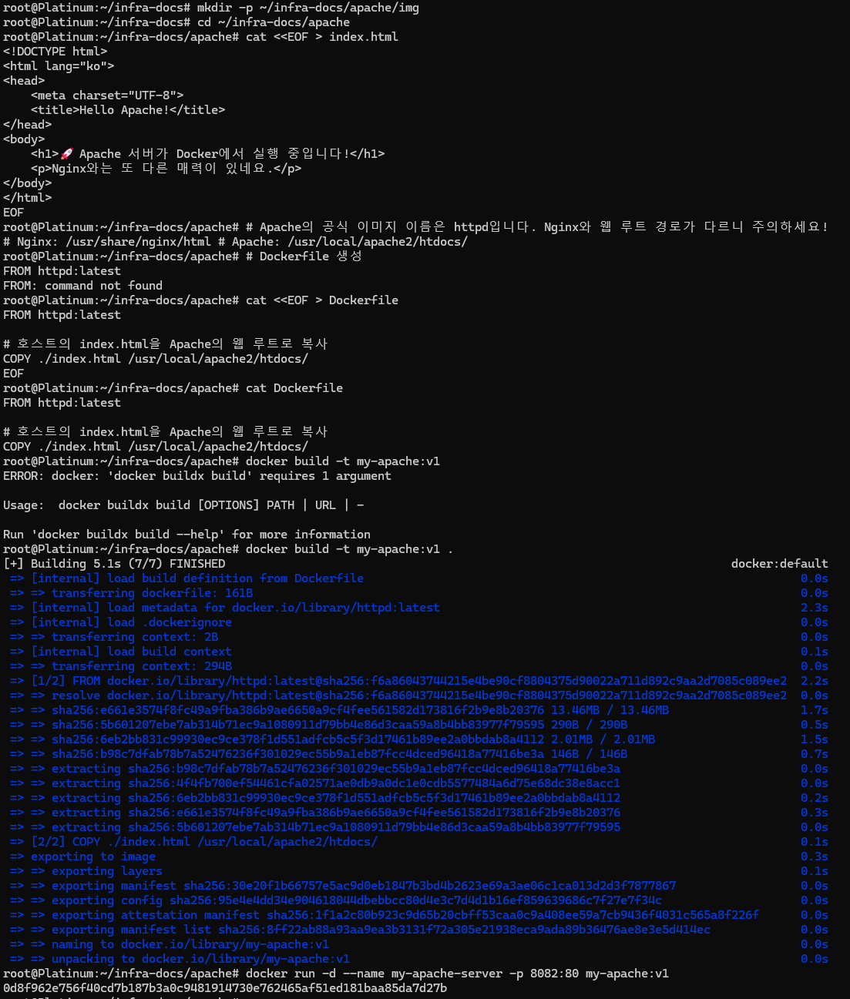
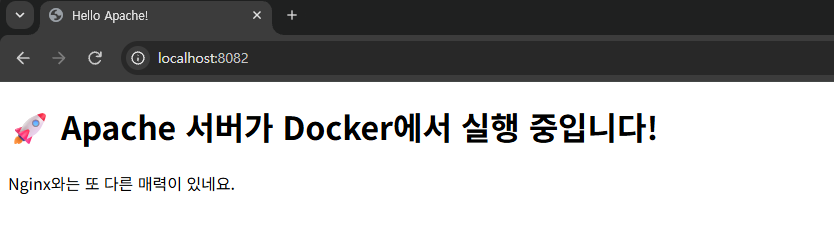

# Apache 서버 구축 실습 (Docker)

## 1. 실습 개요
- Dockerfile을 사용하여 Apache(httpd) 커스텀 이미지를 생성합니다.
- 호스트의 `index.html` 파일을 컨테이너 내부로 복사하여 웹 페이지를 구성합니다.

## 2. 빌드 및 실행 과정 (CLI)
빌드 시 경로 지정(`.`) 오류를 해결하고 성공적으로 컨테이너를 실행했습니다.

## 3. 결과 확인
브라우저에서 포트 8082를 통해 접속한 화면입니다.
