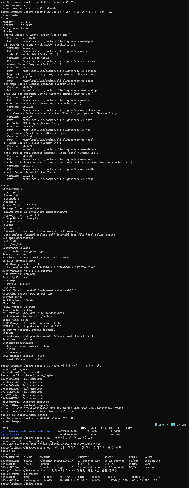
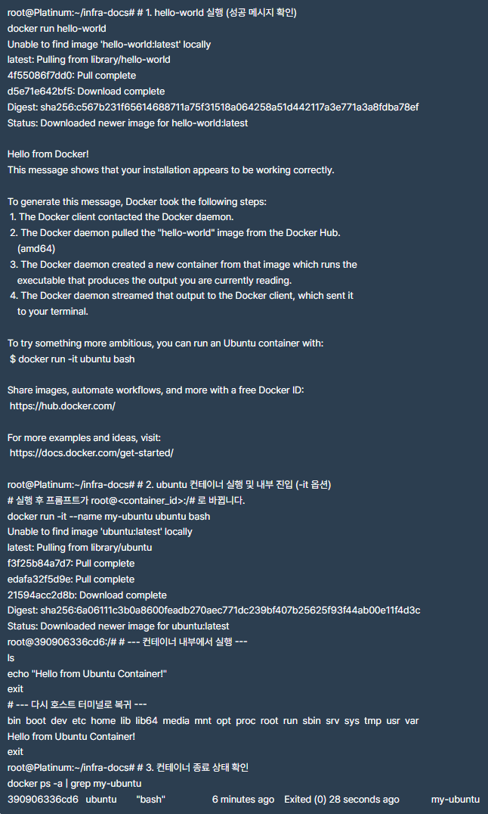
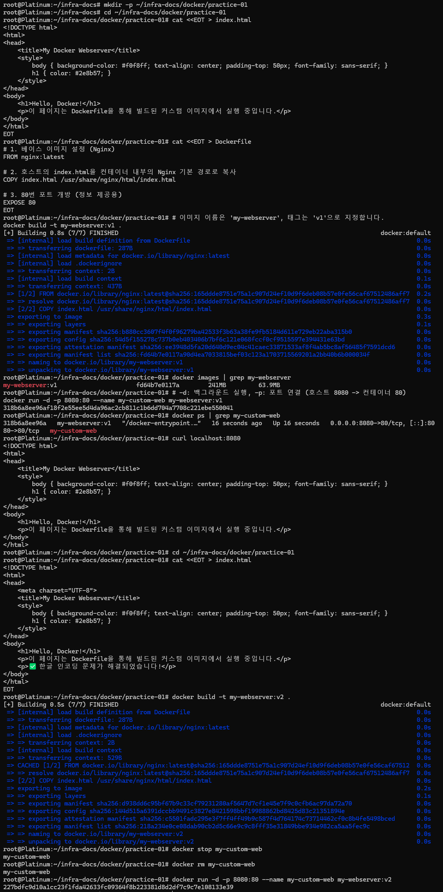
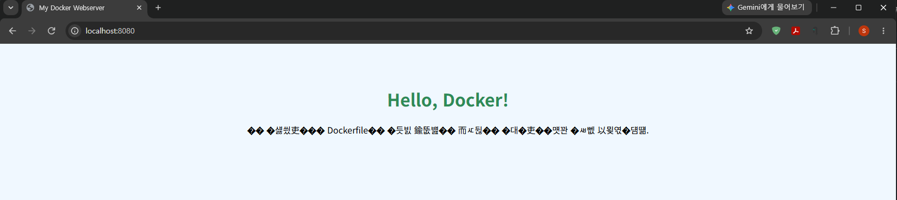
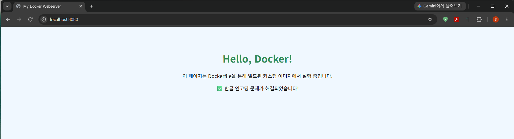
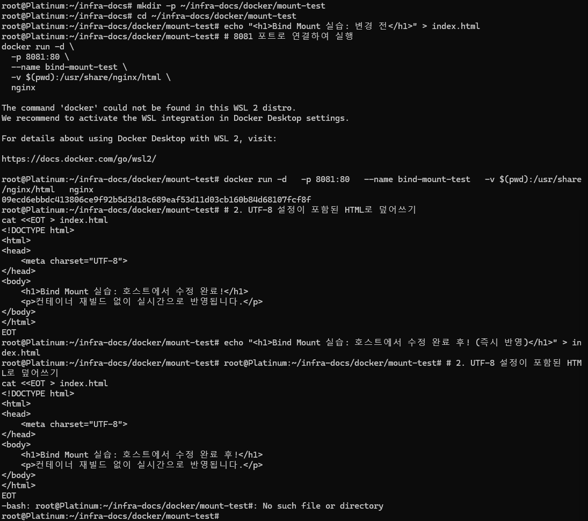
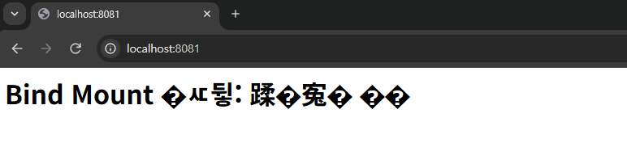
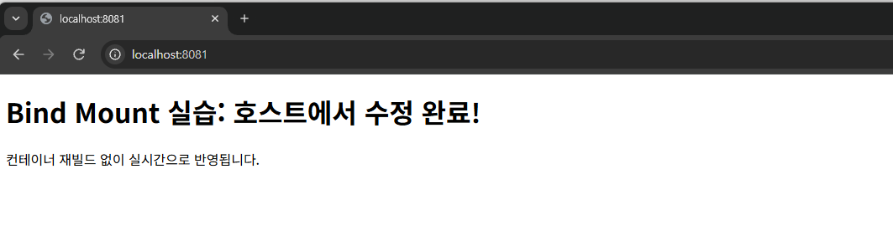
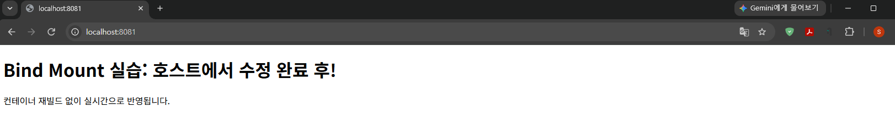

# 🐳 Docker 실습 및 이미지 빌드

이 디렉토리는 Docker의 기초 운영부터 Dockerfile을 이용한 커스텀 웹 서버 이미지 빌드 과정을 기록한 문서입니다.

## 1. 프로젝트 구조
현재 디렉토리에 포함된 주요 파일들입니다.
- [Dockerfile](./Dockerfile): Nginx 기반의 커스텀 이미지 빌드 설정 파일
- [index.html](./index.html): 웹 서버에서 출력될 메인 페이지 (UTF-8 적용)
- `img/`: 실습 증빙 스크린샷 모음

## 2. 주요 실습 내용
1. **Docker 설치 및 상태 확인**: `docker version`, `docker info`
2. **컨테이너 운영**: `run`, `ps`, `logs`, `stats` 명령어 숙달
3. **커스텀 이미지 빌드**: Dockerfile을 활용한 이미지 생성
4. **포트 매핑**: 호스트 8080포트와 컨테이너 80포트 연결

## 3. 실습 증빙 (Screenshots)

### 3.1 Docker 설치 및 초기 설정 확인
Docker 엔진의 버전을 확인하고, 기본 Nginx 이미지를 풀(Pull)하여 컨테이너를 실행하는 과정입니다.


### 3.2 기본 컨테이너 실행 및 관리
`hello-world` 실행을 통한 동작 테스트와 `ubuntu` 컨테이너 내부로 진입하여 명령어를 실행하는 실습입니다.


### 3.3 Dockerfile 빌드 및 이미지 생성 과정
`Dockerfile`과 `index.html`을 작성하고, `docker build` 명령어를 통해 커스텀 이미지를 생성하는 전체 과정입니다.


### 3.4 최종 브라우저 실행 결과 비교

#### 3.4.1 최종 브라우저 실행 화면 (성공 전)
한글 인코딩 설정(`UTF-8`)이 적용되지 않아 브라우저에서 한글이 깨져 보이는 현상입니다.


---

#### 3.4.2 최종 브라우저 실행 화면 (성공)
HTML 헤더에 `<meta charset="UTF-8">`를 추가하고 이미지를 다시 빌드하여 한글이 정상적으로 출력되는 상태입니다.


---
### 3.5 바인드 마운트(Bind Mount) 실습 및 실시간 반영 확인

호스트의 소스 코드 변경이 컨테이너에 즉시 반영되는지 확인하는 실습을 진행했습니다.

#### 1 실습 환경 및 명령어
- **명령어**: `docker run -d -p 8081:80 --name bind-mount-test -v $(pwd):/usr/share/nginx/html nginx`


#### 2 단계별 반영 결과
- **단계 1 (오류)**: 초기 실행 시 한글 인코딩 문제 발생
  
- **단계 2 (해결)**: 호스트에서 `index.html` 수정 후 즉시 반영 확인
  
- **단계 3 (검증)**: 문구 추가 수정 후 실시간 업데이트 최종 확인
  


## 4. 소스 코드 (Source Code)

### Dockerfile
```dockerfile
# Nginx 베이스 이미지 사용
FROM nginx:latest

# 로컬의 index.html을 컨테이너 내부로 복사
COPY index.html /usr/share/nginx/html/index.html

# 포트 설정
EXPOSE 80
index.html
html
📋 복사
<!DOCTYPE html>
<html lang="ko">
<head>
    <meta charset="UTF-8">
    <title>My Docker Webserver</title>
</head>
<body>
    <h1>Hello, Docker!</h1>
    <p>이 페이지는 Dockerfile을 통해 빌드된 커스텀 이미지에서 실행 중입니다.</p>
    <p>✅ 한글 인코딩 문제가 해결되었습니다!</p>
</body>
</html>
작성자: auderyai
최종 수정일: 2026-11-05