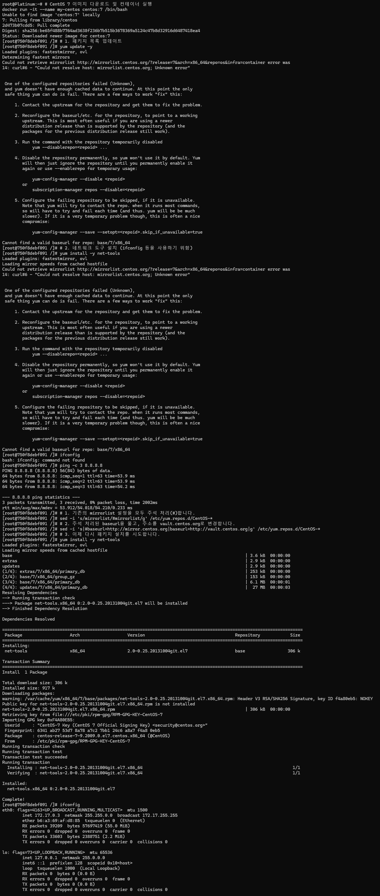

# 3.4.4 CentOS Image 실습

CentOS 7 이미지를 활용하여 컨테이너 환경을 구축하고, 네트워크 도구를 설치하는 과정을 기록합니다.

## 1. 개요
- **이미지**: `centos:7`
- **주요 작업**: 컨테이너 실행, EOL(End of Life) 대응 저장소 수정, `net-tools` 설치 및 네트워크 확인.

## 2. 실습 과정

### 2.1 컨테이너 실행
```bash
docker run -it --name my-centos centos:7 /bin/bash
``` 
2.2 CentOS 7 저장소(Repository) 이슈 해결
CentOS 7은 2024년 6월 30일부로 지원이 종료(EOL)되어 기본 미러 사이트 접속이 불가능합니다. 이를 해결하기 위해 vault.centos.org로 저장소 주소를 변경해야 합니다.

bash
📋 복사
# 1. 기존 mirrorlist 설정을 주석 처리
sed -i 's/mirrorlist/#mirrorlist/g' /etc/yum.repos.d/CentOS-*

# 2. baseurl 주소를 vault.centos.org로 변경
sed -i 's|#baseurl=http://mirror.centos.org|baseurl=http://vault.centos.org|g' /etc/yum.repos.d/CentOS-*
2.3 네트워크 도구 설치 및 확인
저장소 수정 후, yum을 통해 필요한 도구를 설치합니다.

bash
📋 복사
# 패키지 목록 업데이트 및 도구 설치
yum update -y
yum install -y net-tools

# 설치 확인
ifconfig
3. 실습 결과 증빙
ifconfig 명령어를 통해 네트워크 설정이 완료된 것을 확인하였습니다.

CentOS ifconfig 결과


4. 트러블슈팅 노트
에러 메시지: Could not resolve host: mirrorlist.centos.org
원인: CentOS 7 공식 지원 종료로 인한 미러 서버 폐쇄.
해결: sed 명령어를 사용하여 모든 .repo 파일의 주소를 아카이브 서버인 vault 주소로 일괄 변경하여 해결함.