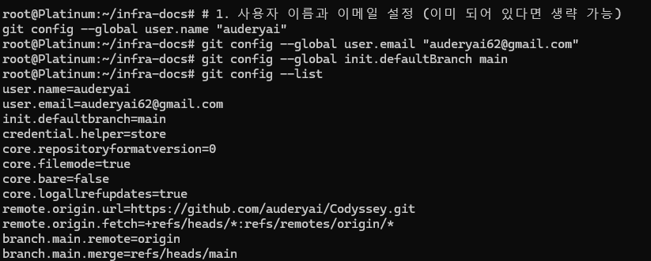
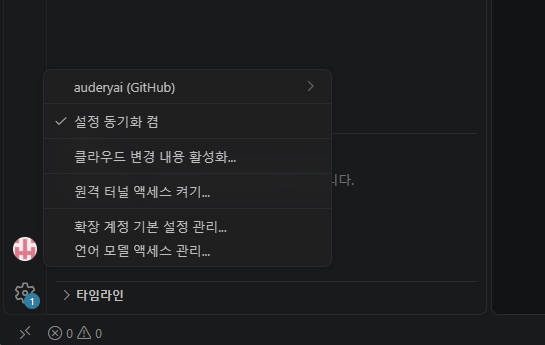

# 1. Git & GitHub 설정 및 연동 실습

프로젝트의 버전 관리와 효율적인 협업을 위해 로컬 Git 환경을 설정하고 GitHub 원격 저장소와 연동을 완료했습니다.

### 1.1 Git 로컬 환경 설정
사용자 식별 정보 등록 및 기본 브랜치 전략, 자격 증명 관리 방식을 설정했습니다.

- **주요 설정 내역**:
  - **사용자 정보**: `auderyai` / `auderyai62@gmail.com`
  - **기본 브랜치**: `main` (기존 master에서 변경)
  - **자격 증명 도우미**: `store` (매번 로그인하는 번거로움 해결)
  - **원격 저장소**: `https://github.com/auderyai/Codyssey.git` 연결 확인

### 1.2 VS Code & GitHub 계정 연동
IDE 환경에서 원활한 소스 제어를 위해 VS Code와 GitHub 계정을 연동했습니다.

- **연동 결과**: 
  - `auderyai` 계정 로그인 완료
  - 설정 동기화(Settings Sync) 활성화로 개발 환경 일관성 유지

---
**💡 학습 포인트**: `git config --list`를 통해 현재 프로젝트에 적용된 모든 설정(로컬/글로벌)을 한눈에 파악할 수 있으며, `remote.origin.url`을 통해 올바른 저장소에 연결되었는지 검증하는 과정이 중요함을 배웠습니다.