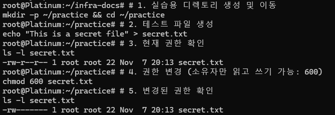

# 🐧 Linux 실습 기록

## 1. 파일 권한 관리 (Permissions)
서버 보안의 기본인 파일 권한을 설정하는 실습입니다.

### 실습 내용
- 파일 생성 및 기본 권한 확인
- `chmod` 명령어를 이용한 권한 변경 (600: 소유자 전용)

### 실행 화면

### 핵심 명령어
- `ls -l`: 파일의 상세 정보 및 권한 확인
- `chmod [8진수] [파일명]`: 파일 권한 변경
